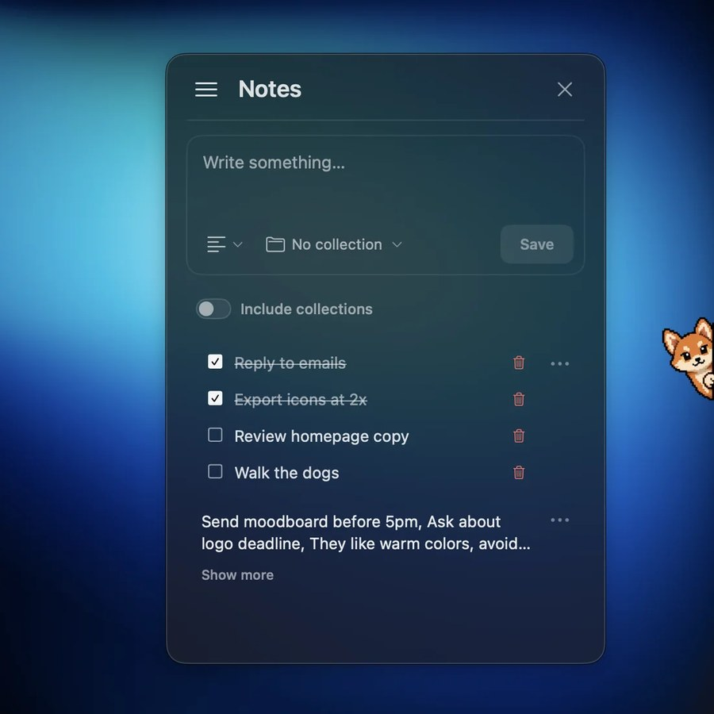
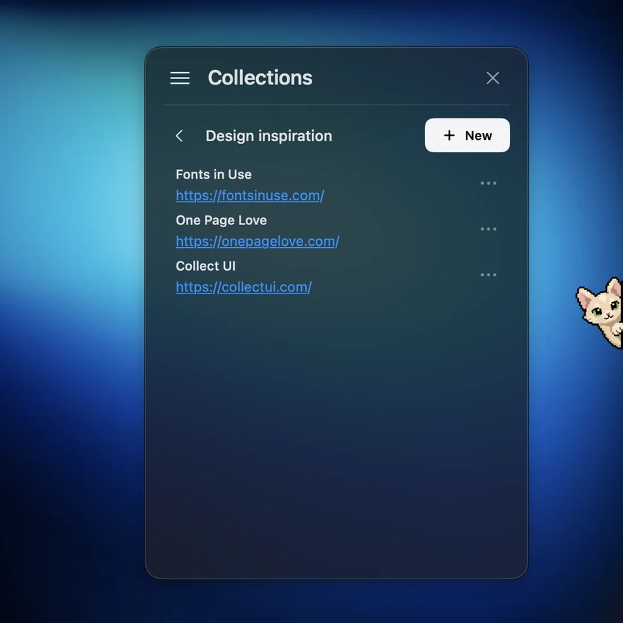
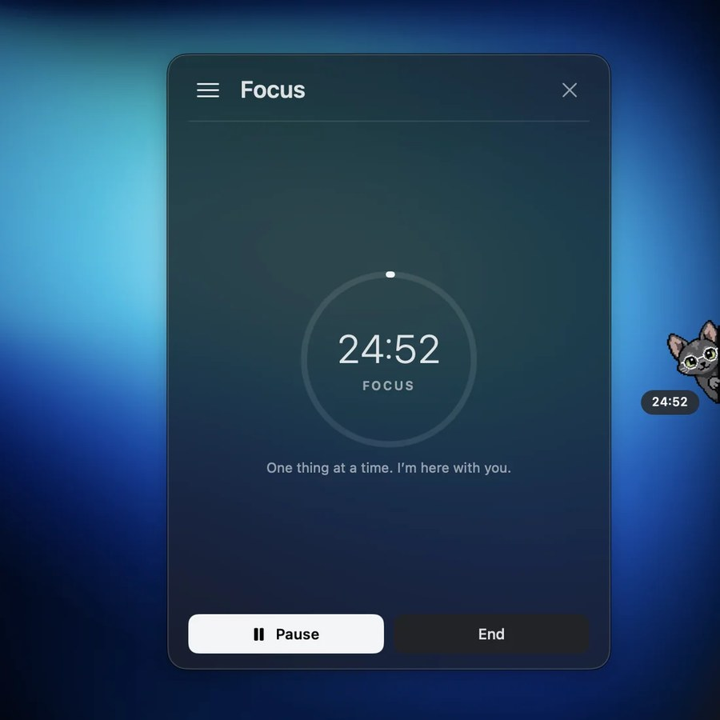
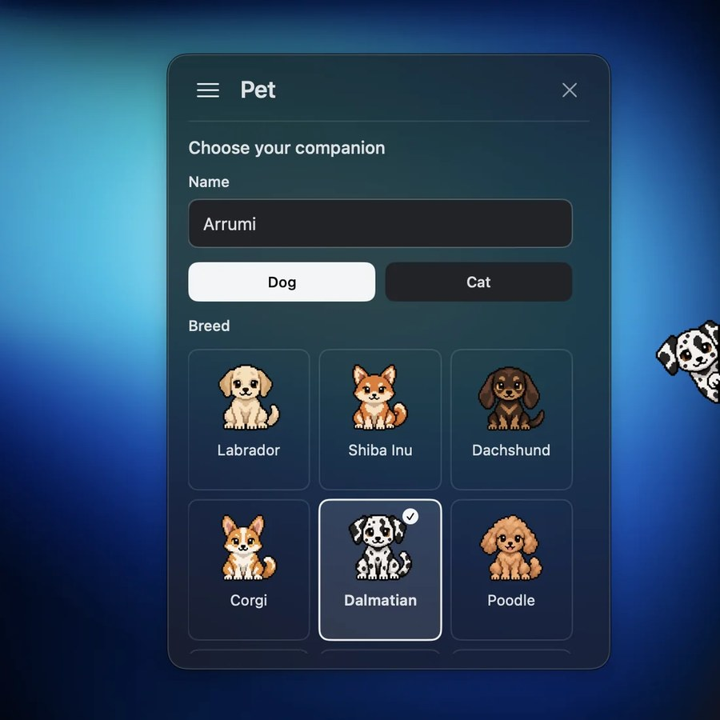

  

<h1 align="center">Arrumi</h1>

  A small desktop companion for Mac. A dog or cat lives at the edge of your screen while you take notes and stay focused.

  

  Version 1.0.1 · Free · macOS 13+ · Apple Silicon · 12.5 MB

  <a href="#a-little-company-for-your-everyday">Explore</a> ·
  <a href="#install">Installation</a> ·
  <a href="https://github.com/danikovalyov/arrumi/releases/tag/v1.0.1">Release notes</a> ·
  <a href="#support">Support</a>

 

## A little company for your everyday

<table>
  <tr>
    <td width="50%" valign="top">
      
      
<b>Notes</b> Write it down before it's gone. Quick notes and checklists, one click away from your pet.

    </td>
    <td width="50%" valign="top">
      
      
<b>Collections</b> Group links and notes by topic, like a folder of design inspiration you keep coming back to.

    </td>
  </tr>
  <tr>
    <td width="50%" valign="top">
      
      
<b>Focus</b> Start a session and the countdown sits right under your pet. One thing at a time.

    </td>
    <td width="50%" valign="top">
      
      
<b>Your companion</b> Give it a name, pick a dog or a cat and choose from 18 breeds.

    </td>
  </tr>
</table>

## Small details, made for you

- **A companion that fits.** 18 breeds, gentle hover reactions and your choice of size, opacity and screen edge.
- **Your own rhythm.** Focus presets, custom sessions from 1 to 999 minutes and a countdown beside your pet.
- **Your space, your style.** A translucent panel, custom colors, and English or Spanish.
- **Local by design.** Notes, settings and drafts stay on your Mac. No account required.

## Install

**Apple Silicon (M1 or newer) · macOS 13 or newer.** This download does not support Intel Macs.

1. Download [`Arrumi-1.0.1-macOS-arm64.dmg`](https://github.com/danikovalyov/arrumi/releases/download/v1.0.1/Arrumi-1.0.1-macOS-arm64.dmg) and open it.
2. Drag **Arrumi.app** onto **Applications** in the installer window.
3. Eject the Arrumi disk, then open Arrumi from Applications.

After opening, look for Arrumi at the edge of your screen and in the menu bar. The introduction appears on a fresh profile.

**Updating:** quit the older Arrumi before replacing it, and keep a copy if you want to roll back. Your existing notes, drafts and settings are kept. The installer contains no personal notes or collections.

A [SHA-256 checksum](https://github.com/danikovalyov/arrumi/releases/download/v1.0.1/Arrumi-1.0.1-macOS-arm64.dmg.sha256) for the installer is available next to it. GitHub's automatic **Source code** archives only contain this repository's documentation, not the app.

Arrumi is **not Developer ID signed or notarized by Apple**. macOS may block it the first time you open it. Follow these steps only if you trust this download.

<strong>macOS blocked Arrumi? First-time opening instructions</strong>

1. Try opening **Arrumi.app** from Applications.
2. If macOS says it can't verify the developer, dismiss the warning without moving the app to Trash.
3. Open **System Settings > Privacy & Security** and look for the message about Arrumi.
4. Choose **Open Anyway**, if it's there, and confirm.

Managed Macs may not allow this. See [Apple's guidance on opening apps safely](https://support.apple.com/102445).

## Support

Found a problem? [Open an issue](https://github.com/danikovalyov/arrumi/issues) with your macOS version, your Mac's processor, what happened and the steps to reproduce it. Please don't attach private notes or personal links.

---

  <a href="https://danikovalyov.com/work/arrumi/">Project page</a> · <a href="https://github.com/danikovalyov">GitHub</a>
   
  Made by <a href="https://danikovalyov.com">Daniel Kovalyov</a>

